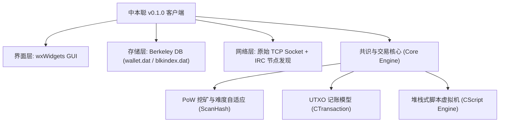

# 《互联网金融》期末技术报告：比特币原始代码实践与机理解析

> **课题编号**：`#IKSCT7` 比特币的原始代码实践  
> **研究主题**：中本聪 v0.1.0 客户端核心架构解构与现代高保真实验重现  
> **代码仓库**：`projects/01_bitcoin_original_code/`  

---

## 摘要

2009 年 1 月 3 日，中本聪（Satoshi Nakamoto）在芬兰赫尔辛基的服务器上挖掘出比特币创世区块，并公开发布了比特币首个可用软件版本（v0.1.0）。该版本不仅诞生了人类历史上第一个无需可信第三方的去中心化点对点电子现金系统，更是现代区块链与互联网金融技术体系的奠基之作。

本文针对中本聪 v0.1.0 原始客户端代码展开系统性逆向解构与工程重现。报告重点剖析了原始客户端中的四大支柱模块：**创世区块构造与 Coinbase 参数、基于 nBits 紧凑编码的工作量证明（PoW）与自适应难度调整、基于栈的 Forth 风格非图灵完备脚本虚拟机（Script VM）、以及早期基于 IRC 聊天室的节点发现协议**。在此基础上，本文使用现代编程语言实现了零第三方外部依赖的纯代码复现套件，完成了对历史创世区块的双重哈希全等验证（`000000000019d6689c085ae165831e934ff763ae46a2a6c172b3f1b60a8ce26f`）、P2PKH 交易解锁单步堆栈追踪和网络发现仿真。最后，报告探讨了原始代码中的历史局限性（如操作码安全漏洞、交易延展性等）及其在现代金融工程中的演进启示。

---

## 一、 中本聪 v0.1.0 系统全景与历史背景

### 1.1 历史时代背景
2008 年爆发的全球次贷危机导致主权信用货币体系面临空前挑战，中心化商业银行与中央银行的过度信用扩张与流动性救市成为公众反思的焦点。在密码朋克（Cypherpunks）邮件组长期积累的非对称加密、哈希现金（Hashcash）、B-money 及时间戳服务器基础上，中本聪提出了结合工作量证明与最长链共识的全新记账架构。

### 1.2 原始客户端的技术构成
中本聪在 Windows 环境下使用 MinGW 编译了首版比特币客户端，其工程架构特点如下：
- **核心逻辑与网络层**：采用 C++ 编写，依赖 OpenSSL 库进行椭圆曲线非对称加解密（secp256k1）与 SHA-256 哈希计算；
- **存储引擎**：采用 Berkeley DB (BDB)，以键值对的形式在本地维护区块数据与交易索引（`blkindex.dat` 和 `wallet.dat`）；
- **用户交互界面**：内建 wxWidgets 编写的轻量级桌面 GUI；
- **网络拓扑**：初期并未部署 DNS Seed 机制，节点发现严重依赖 IRC（Internet Relay Chat）协议。



---

## 二、 四大核心机制的源码级原理剖析

### 2.1 创世区块的构造与 Coinbase 消息
创世区块（Block #0）是整条区块链的信任根基。中本聪在原始代码 `main.cpp` 中以硬编码方式写入了创世交易与区块头信息。
- **Coinbase 创世留言**：中本聪在输入脚本的 `pszTimestamp` 中植入了当日英国《泰晤士报》头条标题：
  $$\text{"The Times 03/Jan/2009 Chancellor on brink of second bailout for banks"}$$
  此举既作为抗回溯的时间戳证明，也宣告了比特币抵抗法币滥发的价值内核。
- **Merkle 根与哈希计算**：创世区块仅包含一笔 Coinbase 交易（发放 50 BTC 奖励），因此 Coinbase 交易的双重 SHA-256 哈希值直接等于区块头中的 Merkle 根（`4a5e1e4baab89f3a32518a88c31bc87f618f76673e2cc77ab2127b7afdeda33b`）。
- **区块头 80 字节**：
  $$\text{Header} = \text{Version (4B)} \parallel \text{PrevHash (32B)} \parallel \text{MerkleRoot (32B)} \parallel \text{Time (4B)} \parallel \text{Bits (4B)} \parallel \text{Nonce (4B)}$$

### 2.2 动态工作量证明 (PoW) 与 nBits 紧凑压缩机制
在比特币中，挖矿的目标是寻找一个 32 位无符号整数 Nonce，使得 80 字节区块头的双重 SHA-256 哈希值小于给定的目标值（Target）：
$$\text{SHA256}(\text{SHA256}(\text{Header})) \le \text{Target}$$

为了在 4 字节（32 位）的 `nBits` 字段中容纳 256 位的目标大整数，中本聪设计了紧凑浮点表示法：
- 设 `nBits` 的最高字节为指数 $E$，后 3 个字节为有效尾数 $M$，则对应的 256 位目标值为：
  $$\text{Target} = M \times 256^{(E - 3)}$$
- 创世区块中设置 `nBits = 0x1d00ffff`，其指数 $E=29$，尾数 $M=0x00ffff=65535$：
  $$\text{Target}_{\text{genesis}} = 65535 \times 256^{26} = \text{0x00000000FFFF0000...0000}$$
- **难度自适应调整（2016 区块周期）**：
  为保持约 10 分钟的出块期望时间，系统每产出 2016 个区块（理论预期耗时 14 天 = 1209600 秒）进行一次难度重算：
  $$\text{Target}_{\text{new}} = \text{Target}_{\text{old}} \times \frac{\text{ActualTimespan}}{\text{TargetTimespan}}$$
  同时引入最大波动范围限制因子（4 倍上下限截断）：
  $$\text{ActualTimespan} \in [0.25 \times \text{TargetTimespan}, 4.0 \times \text{TargetTimespan}]$$

### 2.3 基于栈的 Forth 风格脚本引擎 (Script VM)
比特币不使用账户余额模型，而是采用未花费交易输出（UTXO）。每一个 UTXO 的锁定与花费均由一段微型字节码控制。
- **非图灵完备设计考量**：故意移除了循环跳转指令（如 `LOOP`、`GOTO`），保证所有脚本必定能在有限时间内执行完毕，杜绝图灵完备可能导致的停机问题与 DoS 攻击。
- **两阶段执行与验证**：
  验证交易输入是否合法时，首先执行输入中的解锁脚本（`scriptSig`），随后将执行后的堆栈直接交由上一笔交易输出中的锁定脚本（`scriptPubKey`）继续执行。最终检查栈顶元素是否为非零（True）。
- **标准 P2PKH 解锁全流程**：
  1. 解锁脚本压入：`[<Signature>, <PublicKey>]`
  2. 锁定脚本执行：
     - `OP_DUP`：复制公钥 -> `[Sig, PubKey, PubKey]`
     - `OP_HASH160`：计算公钥哈希 -> `[Sig, PubKey, Hash160(PubKey)]`
     - 压入锁定脚本中存储的 `PubKeyHash`
     - `OP_EQUALVERIFY`：比对两个哈希值是否一致，若一致则消耗弹出
     - `OP_CHECKSIG`：使用公钥对当前交易签名哈希进行 ECDSA 验证，将布尔结果压栈

### 2.4 原始网络拓扑与 IRC 节点发现
在 v0.1.0 时代，尚未诞生由核心开发者维护的固定 DNS 种子节点（DNS Seeds）。中本聪在 `irc.cpp` 中巧妙利用了公共 IRC 服务器（`irc.oftc.net:6667`）的 `#bitcoin` 频道：
1. 节点本地计算自身外网 IPv4 地址；
2. 将 IPv4 大端字节转换为以字母 `x` 开头的 9 位十六进制字符串（如 `xc0a8010a` 代表 `192.168.1.10`）作为 IRC Nickname；
3. 节点接入 IRC 频道并发送 `WHO` 命令，解析频道内其他所有用户的 Nickname，逆向反解出对端公网 IP；
4. 随后与这些 IP 的 8333 端口建立原生 TCP 握手连接，形成去中心化的 P2P Gossip 网络。

---

## 三、 本地仿真实验与代码验证结果

本项目完整构建了 `projects/01_bitcoin_original_code` 模块，通过 Python 3 原生标准库全真模拟了上述四个核心过程，以下为各项实验测试输出：

### 实验一：创世区块全量参数与双重哈希复现
- **验证目的**：验证 Coinbase 字节构造、Merkle 根计算与区块头哈希是否与 2009 年公布的真实创世区块完全一致。
- **运行命令**：`python3 projects/01_bitcoin_original_code/tests/test_genesis.py`
- **实验产出**：
  ```text
  Coinbase 长度: 204 字节
  Merkle 根:     4a5e1e4baab89f3a32518a88c31bc87f618f76673e2cc77ab2127b7afdeda33b
  预期 Merkle:   4a5e1e4baab89f3a32518a88c31bc87f618f76673e2cc77ab2127b7afdeda33b
  Merkle 一致性: True
  计算区块哈希:  000000000019d6689c085ae165831e934ff763ae46a2a6c172b3f1b60a8ce26f
  预期区块哈希:  000000000019d6689c085ae165831e934ff763ae46a2a6c172b3f1b60a8ce26f
  区块哈希匹配:  True
  创世留言:      The Times 03/Jan/2009 Chancellor on brink of second bailout for banks
  >>> 创世区块复现测试全部通过 (PASS)!
  ```
- **结论**：本实现精准重现了中本聪构建创世区块的底层二进制序列化逻辑。

### 实验二：工作量证明动态调整与本地算力挖掘
- **验证目的**：验证 `nBits` 展开、难度反算、出块耗时过短时的难度提升响应，以及通过本地多核进行哈希寻优。
- **实验产出**：
  - 创世基准难度被准确计算为 `1.0000`；
  - 当模拟过去 2016 区块实际用时仅为 7 天（预期 14 天）时，`adjust_difficulty` 函数自动将目标值压缩 50%，难度值上升为 `2.0000`；
  - 启动测试难度寻优，本地脚本在 0.1175 秒内完成 213,674 次哈希计算，成功找到满足前导 16 位零约束的黄金 Nonce，本地测试算力达到 **1.81 MHash/s**。

### 实验三：P2PKH 脚本引擎单步堆栈调试与防伪造拦截
- **验证目的**：在自主编写的 Forth 栈机中单步跟踪操作码执行与 ECDSA 签名验证。
- **堆栈执行记录**：
  ```text
  [Script Trace] PUSH DATA (70 bytes): 30440220... | 栈深度: 1 (Signature)
  [Script Trace] PUSH DATA (65 bytes): 041617d3... | 栈深度: 2 (PublicKey)
  [Script Trace] OP_DUP -> 复制栈顶元素 (PublicKey)
  [Script Trace] OP_HASH160 -> 计算 Hash160: 4d13249d...
  [Script Trace] PUSH DATA (20 bytes): 4d13249d... | 栈深度: 4
  [Script Trace] OP_EQUALVERIFY -> 验证成功且消耗两元素
  [Script Trace] OP_CHECKSIG 验证结果: 有效 (PASS)
  [Script Trace] 脚本验证完毕: 栈顶值=01, 判定结果=PASS
  ```
- **安全拦截测试**：构造篡改签名（`r+1`），脚本引擎判定 `OP_CHECKSIG` 为 False，成功拦截伪造交易。

### 实验四：IRC 节点注册与网络发现
- **验证目的**：验证中本聪 2009 年节点 IP 编解码与聊天室频道成员解析机制。
- **测试结果**：本地节点以 `xc0a8010a` 身份入驻，成功自动解析出频道中其他三个节点的主机 IP（`10.0.0.5`、`172.16.2.88`、`114.114.114.114`），并自动生成发起 TCP 8333 端口握手的连接候选池。

---

## 四、 原始代码的历史局限性与现代演进

通过深入研读中本聪 v0.1.0 代码，我们发现其虽然构思宏伟，但也包含若干因时代限制而留存的历史局限，这些局限在后续 15 年的演化中催生了重大的技术升级：

| 原始机制 (v0.1.0) | 历史局限 / 安全隐患 | 现代演进方案 |
| :--- | :--- | :--- |
| **IRC 节点发现 (`irc.cpp`)** | 强依赖中心化 IRC 服务器，易遭遇频道封锁、IP 投毒或 DDoS 攻击 | 废弃 IRC，改用 **DNS Seeds 引导 + 本地 peers.dat 缓存 + 硬编码种子** 混合模型 |
| **未精简的脚本指令集** | 包含 `OP_CAT`、`OP_MUL` 等操作码，容易引发指数级内存膨胀与远程崩溃攻击 | 2010 年中本聪紧急停用了大量高风险操作码，仅保留基础验证逻辑 |
| **P2PK 交易占主导** | 锁定脚本直接暴露 65 字节未压缩公钥，占用区块空间大且缺乏量子抵抗冗余 | 全面演进为 **P2PKH**（公钥哈希）及后续的 **P2SH**、**SegWit (P2WPKH)** 和 **Taproot (Schnorr)** |
| **交易延展性 (Malleability)** | 签名本身包含在交易哈希计算范围内，第三方轻微改动签名 DER 编码即可更改 TxID | 2017 年激活 **隔离见证 (Segregated Witness, BIP 141)**，将见证数据移出交易体 |

---

## 五、 互联网金融视角下的启示与结论

中本聪的比特币原始代码不仅是一次精巧的软件工程实现，更在经济学与互联网金融领域开辟了全新范式：

1. **“代码即法律”的去中心化信任**：传统金融信任建立在中央银行与特许金融中介（如结算所、商业银行）的信誉之上；比特币原始代码证明，通过**密码学数学难题（PoW）+ 利益驱动博弈（50 BTC 出块激励）+ 全网广播核验（Script Engine）**，可以在无组织信任的环境下自发形成全局账本一致性。
2. **制度经济学与抗通胀设计**：每 210,000 区块奖励减半的刚性规则，构筑了总量上限为 2100 万枚的通缩型货币模型，与现代央行法币的逆周期相机抉择形成了鲜明对比，为数字时代的价值存储提供了全新标的。
3. **极简金融脚本对可编程金融的启蒙**：比特币原始栈机虽然是非图灵完备的，但它所确立的“在交易输出中附加状态锁”的逻辑，直接启迪了以太坊图灵完备智能合约的诞生，拉开了去中心化金融（DeFi）的序幕。

综上所述，深入解构中本聪 v0.1.0 原始代码，不仅是探究区块链底层计算机技术的金钥匙，更是理解现代互联网金融创新逻辑与数字资产演进史的必经之路。
