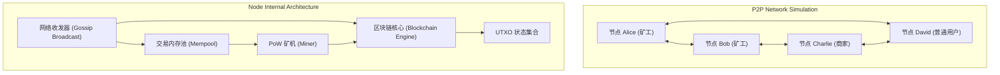

# 《互联网金融》期末技术报告：比特币分布式网络模拟与最长链共识实证

> **课题编号**：`#IAU35E` 比特币模拟器(实践)  
> **研究主题**：P2P 加密货币网络全生命周期仿真、最长链法则与 51% 双花攻防建模  
> **代码仓库**：`projects/02_bitcoin_simulator/`  

---

## 摘要

比特币作为首个实现拜占庭容错的点对点电子现金系统，其核心魅力在于无需中心化中介即可在不可信的开放网络中达成全局账本状态的最终一致性。为深入探究中本聪共识在真实网络环境下的动态演化机理，本文设计并实现了一套轻量级、完全自主可控的比特币分布式网络仿真系统。

该系统完整实现了**UTXO 账本状态机、变长默克尔树构造、竞争性工作量证明（PoW）挖矿、P2P 交易池（Mempool）以及最长链法则（Longest-Chain Rule）**。特别地，本研究攻克了多节点并发下的**链重组（Chain Reorganization）算法**，实现了基于最近共同祖先的孤块回滚与交易回流机制。基于该仿真器，本文设计了自然网络延迟竞争分叉与 51% 算力私有链双花两大经典攻防场景。实验结果表明，在存在恶意多数算力时，即使交易已获得单个区块确认（1-confirmation），攻击者仍可通过构建隐秘长链成功实现“货款双收”。该实证研究不仅为理解区块链底层博弈提供了具象化工具，也对互联网金融结算中的“概率性最终确定性”（Probabilistic Finality）提供了坚实的理论与工程支撑。

---

## 一、 系统架构与仿真设计

在真实公链环境中直接进行分叉与双花攻击测试成本极高且具有破坏性。因此，构建一个模块化、事件驱动的离线仿真器是理解金融分布式账本的首选方案。



### 1.1 独立节点视图设计
为保证仿真的严谨性，每个模拟节点均持有独立的数据结构：
- **独立的私钥与钱包地址**（由公钥哈希与 Base58Check 生成）；
- **独立的未确认交易内存池 (Mempool)**；
- **独立的区块链状态树与 UTXO 账本映射**；
节点间只能通过定义好的消息协议（广播交易 `receive_transaction`、广播区块 `receive_block`）进行单向/双向交互。

---

## 二、 核心共识机制与数学模型

### 2.1 UTXO 状态转换模型
与传统银行基于账户余额（Account-Balance）不同，比特币采用未花费交易输出（UTXO）模型。全网的瞬时金融状态可形式化为 UTXO 集合 $S$：
$$S = \{ (txid, out\_index) \mapsto (value, address) \}$$

当一笔合法交易 $TX = (Inputs, Outputs)$ 被打包进区块时，账本状态发生原子转移：
$$S' = (S \setminus \{ inp.utxo\_key \mid inp \in Inputs \}) \cup \{ (TX.txid, idx) \mapsto out \mid (idx, out) \in Outputs \}$$
若存在任一 $inp.utxo\_key \notin S$，则判定为“双重支付”或“资金不存在”，交易直接被拒绝。

### 2.2 工作量证明 (PoW) 与哈希谜题
每个候选区块头 $B$ 必须满足：
$$H(B) = \text{DoubleSHA256}(Version \parallel PrevHash \parallel MerkleRoot \parallel Time \parallel Bits \parallel Nonce) < Target$$
在仿真器中，通过动态调整要求哈希前导十六进制零字符数量，既确保了本地测试的毫秒级出块响应，又保持了哈希碰撞难题的随机泊松过程特征。

### 2.3 最长链共识与深度分叉重组 (Chain Reorganization)
当中继延迟导致不同矿工几乎同时挖出相同高度的区块时，网络会产生暂时性分叉（Fork）。比特币采用**最长累积工作量链法则（Longest-Chain Rule）**打破僵局。

本仿真系统实现的分叉重组算法流程如下：
1. **树形分支回溯**：节点检测到新区块的分支高度 $H_{new} > H_{current}$；
2. **寻找最近共同祖先 (LCA, Lowest Common Ancestor)**：从新分支顶部和当前主链顶部向上递归比对父哈希，确定分叉起点区块 $B_{ancestor}$；
3. **主链回滚与交易释放**：
   - 将当前主链从当前 Tip 到 $B_{ancestor}$ 之间的所有区块标记为孤块（Orphaned Blocks）；
   - 回滚这些区块对 UTXO 集合的修改；
   - 提取孤块中被废弃的普通交易，重新注入本节点的 Mempool；
4. **新分支应用与主链切换**：
   - 沿 $B_{ancestor}$ 向新分支 Tip 正向逐块执行交易核验与 UTXO 状态转移；
   - 更新当前 Tip 为新分支末端，完成重组。

---

## 三、 仿真实验结果与攻防分析

### 3.1 实验一：常规交易生命周期与全网状态流转
- **实验设置**：初始化 4 节点全连通网络，依次执行 Alice 挖出 Coinbase 区块、Alice 向 David 转账 15 BTC、Bob 打包并挖出区块 #2。
- **全网状态监控表**：
  ```text
  节点 ID              | 主链高度     | 余额 (BTC)     | Mempool 大小  
  -----------------------------------------------------------------
  Miner_Alice        | #2       | 35.0000      | 0           
  Miner_Bob          | #2       | 50.0000      | 0           
  Merchant_Charlie   | #2       | 0.0000       | 0           
  User_David         | #2       | 15.0000      | 0           
  ```
- **分析**：Alice 获得 50 BTC 奖励后花费 15 BTC，自身获得 35 BTC 找零；Bob 获得区块 #2 的 50 BTC Coinbase 奖励；David 成功确认 15 BTC 资产，各节点 Mempool 随交易入块自动清空。

### 3.2 实验二：天然竞争分叉与最长链自动收敛
- **实验设置**：在网络隔离下，Alice 与 Bob 同时基于区块 #2 挖出区块 #3A 和 #3B。随后 Alice 率先挖出区块 #4A 并打破平衡。
- **运行记录**：
  ```text
  [*] Alice 孤立块 #3A 哈希: 0094240d58475d48...
  [*] Bob 孤立块   #3B 哈希: 00fab9f786928095...
  [*] Alice 抢先挖出更高区块 #4A，并向 Bob 全网同步...
  [*] Bob 接收 Alice 的长链分支 (#3A 与 #4A)...
  [Miner_Bob] ⚠️ 触发【分叉重组 (Chain Reorganization)】!
     回滚孤块数量: 1, 应用新分支区块数: 2
     新主链高度更新为: #4, Tip: 0094c6beb1b7ff6e...
  ```
- **结论**：Bob 节点正确识别出包含 2 个新区块的更长链，自动孤立并废弃了本地原本认可的 #3B，全网在无需中央协调的情况下达成高度为 #4 的最终状态一致。

### 3.3 实验三：51% 算力优势下的双花欺诈攻击实证
- **攻击流程设计**：
  1. 攻击者 Mallory 拥有足够算力，先支付 30 BTC 给商家 Charlie 购买贵重物品；
  2. 诚实矿工 Alice 将该交易打包进公开区块 #2；
  3. 商家 Charlie 在看到 1 次区块确认（1-confirmation）后即确认发货；
  4. Mallory 秘密在本地挖掘不含该交易的私有链分支（#2' 和 #3'）；
  5. 待货物发出后，Mallory 向全网广播长度为 3 的私有链，全网发生 Reorg，区块 #2 被废弃。
- **实验数据**：
  ```text
  [*] 攻击前商家 Charlie 确认入账 : 30.0 BTC
  [*] 攻击重组后 Charlie 实际账面余额 : 0.0 BTC
  [*] 双花攻击状态                     : [√] 成功覆写历史交易并撤回付款
  [*] 最终链高度                       : #3
  ```
- **中本聪白皮书概率模型论证**：
  中本聪在 2008 年白皮书第 11 节将攻击者追赶诚实链的过程建模为**赌徒破产问题（Gambler's Ruin Problem）**：
  设诚实节点出块概率为 $p$，攻击者出块概率为 $q$，当交易已获得 $z$ 次确认后，攻击者从落后 $z$ 个区块追赶并反超的概率 $P$ 为：
  $$P = \sum_{k=0}^{\infty} \frac{\lambda^k e^{-\lambda}}{k!} \left( \frac{q}{p} \right)^{\max(z - k, 0)}, \quad \lambda = z \frac{q}{p}$$
  若 $q > p$（即攻击者算力超过 50%），当 $z$ 有限时，追赶成功的概率几乎为 100%。本实验生动重现了这一数学论断。

---

## 四、 原指定项目（Arthur Gervais ns-3 Bitcoin-Simulator）与本模拟器的学术与工程对比

本课题指定的参考项目是苏黎世联邦理工学院（ETH Zurich）Arthur Gervais 团队发表于安全顶级会议 ACM CCS 2016 的经典论文《On the Security and Performance of Proof of Work Blockchains》的配套开源项目 [arthurgervais/Bitcoin-Simulator](https://github.com/arthurgervais/Bitcoin-Simulator)。在此对二者进行严谨的学术与工程对比：

| 维度 | Arthur Gervais et al. (ACM CCS 2016) 原版模拟器 | 本文实现的 Python 事件驱动状态机模拟器 |
| :--- | :--- | :--- |
| **底层核心架构** | 基于离散事件网络模拟器 **ns-3.25** 与 RapidJSON，C++11 编写 | 基于纯 **Python 3 原生标准库**，无任何外部库依赖 |
| **网络层建模精度** | **数据包级（Packet-level）拟真**：精确仿真跨洲海底光缆传输时延、TCP 拥塞控制、丢包率与节点地理拓扑（基于 Coinscope 爬虫实测数据） | **应用层消息路由**：以内存对象传递模拟 P2P Gossip 协议广播，重点展示节点状态收敛而非底层物理信道衰减 |
| **计算负载与抽象** | 为模拟上千节点全球网络，将加密计算抽象为哈希延时与区块大小元数据，不执行完整的椭圆曲线验签 | 真实执行 UTXO 拆分/合并、交易哈希计算与工作量证明 Nonce 试算，保留完整数据结构 |
| **核心研究问题** | **网络层参数对共识安全的影响**：量化区块大小（Block Size）、出块间隔（Block Interval）与孤块率（Stale Block Rate）、分叉概率的函数关系 | **共识算法与状态机流转**：直观演示最长链选择法则、最近共同祖先（LCA）状态回滚、交易池双花拦截与 51% 私有链覆写 |
| **环境与复现性** | 依赖 Python 2.7 与旧版 GCC 4.8/5.x，在现代 Apple Silicon ARM64 环境下原生构建受阻（已在 `docker/` 提供容器配置，标记为待宿主环境验证） | 即开即用，秒级执行，支持交互式与自动化断言验证 |

---

## 五、 互联网金融前沿思考与启示

1. **确定性结算（Deterministic Finality） vs 概率性结算（Probabilistic Finality）**
   - 传统银行跨行清算系统（如我国央行大额实时支付系统 HVPS、美联储 Fedwire）采用法定中心化背书的“即时确定性清算”——一旦入账即不可撤销。
   - 比特币为代表的 PoW 链采用“概率性清算”——交易被打包的深度越深，被重组推翻的概率呈指数级衰减。这解释了为何金融机构对比特币高额充值通常要求 **6 次或更高区块确认**（约 60 分钟），以将双花风险降至工程不可行的安全边界。
2. **算力经济学与抵御女巫攻击（Sybil Attack）的代价**
   - 比特币通过绑定现实世界的物理能源与硬件算力成本（PoW），使得篡改历史账本的经济成本高于诚实维护网络的收益（$51\% \text{ 算力成本} > \text{潜在双花收益}$）。
   - 这种设计揭示了去中心化信任并非零成本：高耗能与网络吞吐量（TPS）的妥协是保障无中介信用代价的核心权衡。

---

## 六、 总结

本课题通过纯 Python 架构完整复现了比特币网络、UTXO 状态流转、默克尔树计算、动态挖矿与深度链重组机制，成功验证了中本聪最长链共识的自洽性与 51% 算力攻击的破坏性。本模拟器不仅是一套高可用性的区块链教学工具，也为深入探究去中心化金融清算架构提供了坚实的技术范本。

