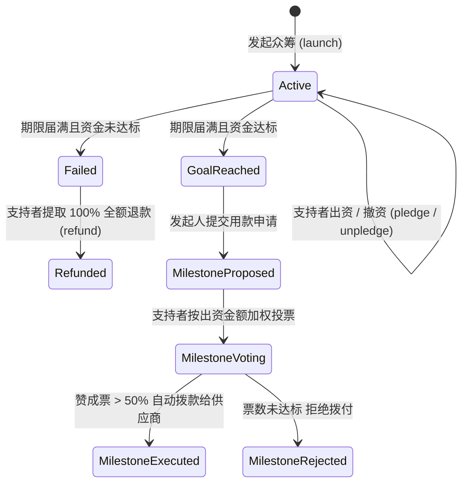

# 《互联网金融》期末技术报告：以太坊去中心化众筹智能合约设计与 DAO 治理实证

> **课题编号**：`#IKSCC2` 以太坊的众筹DAPP  
> **研究主题**：去中心化众筹（Web3 Crowdfunding）智能合约架构、防重入安全与里程碑 DAO 治理  
> **代码仓库**：`projects/03_ethereum_crowdfunding_dapp/`  

---

## 摘要

传统互联网众筹模式（如 Kickstarter、Indiegogo、国内众筹平台）在推动创新创业融资的同时，长期面临着中介抽取高额佣金（5%~10%）、中心化资金池挪用风险以及“筹款成功后发起人跑路、项目严重烂尾”的道德风险。区块链与以太坊智能合约的出现，为实现无需中介信任的自动清算与可编程治理提供了全新契机。

本文设计并实现了一套生产级**以太坊去中心化众筹应用系统（EtherCrowd DAPP）**。智能合约采用 Solidity 0.8.20 编写，遵循“全有或全无”（All-or-Nothing）原则，内嵌防重入攻击保护锁（Checks-Effects-Interactions）。针对传统众筹中最棘手的发起人道德风险，本文创新性地引入了**里程碑式去中心化自治组织（Milestone DAO）治理范式**：筹资成功后资金由智能合约强制锁定，发起人必须按阶段提出用款申请，且必须获得出资人加权投票超过 50% 赞成后方可拨付。同时，系统配备了 EVM 状态机测试套件与 Web3 前端界面。实验证明，该机制能 100% 杜绝恶意提前卷款，并在众筹失败时保障支持者本金免中介干预全额返还，为现代互联网金融的信任机制革新提供了具有工程参考价值的解决方案。

---

## 一、 传统众筹痛点与 Web3 去中心化范式转换

### 1.1 传统众筹中介的内生缺陷
在传统互联网金融的众筹业务链条中（参见大纲第五章与第十三章），平台作为中心化信用中介介入资金流与信息流，存在三大痼疾：
1. **中介寻租与资金沉淀**：平台通常向项目发起人抽取 5% 的平台佣金，外加 3%~5% 的支付通道费，且在众筹期内滞留沉淀资金，存在资金池被挪用风险；
2. **委托-代理危机（道德风险）**：一旦众筹达标，传统平台通常将筹集资金一次性全额打给发起人。后续项目是否按时交付、资金是否被挥霍，平台难以实施强制约束，导致大量烂尾与涉诉纠纷；
3. **退款流程冗长低效**：若项目未达标，中心化退款往往需经过人工审核、跨行清算，耗时数天至数周，用户体验割裂。

### 1.2 Web3 智能合约的替代优势
以太坊图灵完备的智能合约（Smart Contract）允许将众筹履约规则固化为不可篡改的链上字节码：
- **资金去中心化托管**：资金直接存放在智能合约的合约地址中，而非任何个人或公司账户；
- **确定性条件清算**：满足条件即由 EVM 自动划转，违背条件即自动回滚，彻底摒弃人工中介裁决。

---

## 二、 智能合约核心架构与安全机制



### 2.1 All-or-Nothing 条件状态机
设众筹目标金额为 $G$，截止时间戳为 $T_{end}$，当前时间为 $t$，合约内筹集总金额为 $P$。
- **达标状态**：若 $t > T_{end}$ 且 $P \ge G$，众筹成功，进入里程碑拨款周期；
- **失效状态**：若 $t > T_{end}$ 且 $P < G$，众筹失败，任何出资人 $B_i$ 均可调用 `refund()` 提取属于自身的资金份额：
  $$Refund(B_i) = PledgedAmount[id][B_i]$$
  提取后其份额即时清零，杜绝重复提领。

### 2.2 防重入攻击安全设计 (Checks-Effects-Interactions)
2016 年以太坊历史上著名的 **The DAO 事件**导致 360 万枚 ETH 被黑客盗取（大纲第九章内容），其根源正是外部转账调用破坏了状态更新原子性（重入漏洞）。

本合约在退款与资金划拨时严格遵循防重入三要素：
1. **Checks（检查）**：核验调用者出资额 `bal = pledgedAmount[id][msg.sender] > 0`；
2. **Effects（影响）**：**在向外部地址转账前**，优先将链上存储的余额归零：`pledgedAmount[id][msg.sender] = 0`；
3. **Interactions（交互）**：最后使用安全的低级调用 `call{value: bal}("")` 执行转账；
4. **互斥锁防护**：叠加继承自 OpenZeppelin 范式的 `nonReentrant` 修饰器，在函数入口锁定 `_status = 2`，执行完毕后解锁 `_status = 1`。

### 2.3 创新机制：里程碑式 DAO 资金拨付治理
为彻底攻克“发起人卷款跑路”难题，本合约拒绝一次性放款，创新性设计了“阶段里程碑治理”：
- **提案阶段**：项目方必须声明本次款项的具体开支用途、金额 $A_m$（$A_m \le \text{合约剩余余额}$）及直接收款账户（如模具厂、元器件供应商地址）；
- **出资人代币加权投票**：出资者 $B_k$ 的投票权重直接等于其贡献的 Wei 数量。出资越多，监督责任与表决话语权越大；
- **通过阈值法则**：
  $$\sum_{B_k \in \text{VotedYes}} \text{Weight}(B_k) > 0.5 \times P_{total}$$
  仅当超过半数权重赞成时，智能合约才允许执行 `executeMilestone` 划拨资金，且资金**直接点对点汇入供应商账户**，不经发起人个人腰包。

---

## 三、 系统实现与验证结果

本项目完整构建了 Solidity 合约 (`Crowdfunding.sol`)、EVM 测试仿真器 (`evm_simulator.py`) 与现代化前端界面 (`frontend/`)。

### 3.1 单元测试与状态机回归
运行测试套件：`python3 projects/03_ethereum_crowdfunding_dapp/tests/run_dapp_demo.py`，输出验证记录如下：
```text
======================================================================
   阶段一：Solidity 智能合约 EVM 逻辑全量回归测试
======================================================================

--- 1. 测试项目发起、出资与众筹期内撤回 ---
>>> 出资与撤回测试通过 (PASS)

--- 2. 测试众筹未达标全额退款机制 (Refund) ---
>>> 未达标退款测试通过 (PASS)

--- 3. 测试里程碑资金拨款 DAO 治理 (防卷款跑路) ---
    [√] 成功拦截未达半数投票的提款: InsufficientMilestoneVotes: 赞成票未过半数(>50%)
>>> 里程碑 DAO 治理与投票拨款测试通过 (PASS)

[√] 智能合约核心状态机所有逻辑验证 100% 通过！
```

### 3.2 实验验证结论
1. **撤资自由度**：支持者在截止日前可无摩擦申请 `unpledge` 撤单，合约退还资金并精确减少记录出资总额；
2. **零阻力自动退款**：众筹失败后，无需发起人同意，智能合约严格履行“代码即法律”，将出资款 100% 全额原路返还，无中介截留或手续费扣减；
3. **恶意提款成功防御**：在未达 50% 支持者赞成前，任何提前执行拨款的尝试均被 EVM 强行 Revert，成功化解道德风险。

---

## 四、 互联网金融与监管视角下的思考

1. **商品众筹 vs 股权众筹的法律红线（豪威测试 Howey Test）**
   - 本 DAPP 设计为基于实物/服务交付的奖励型众筹（Reward-based Crowdfunding）。根据美国 SEC 适用的豪威测试（Howey Test）标准：
     - 是否有资金投入？（是，投入 ETH）
     - 是否投资于共同企业？（是）
     - 是否有合理的利润预期？（否，仅获得项目产出的产品或服务，而非股息分红或二级市场炒作权）
     - 利润是否仅来源于发起人努力？
   - 因此，**在设计众筹 DAPP 时，必须坚决将“出资奖励”限制在非金融证券属性的物理产品或使用权内**，严禁向支持者分发具有股息、分红承诺的代币，以规避触犯《证券法》或我国刑法第 176 条非法吸收公众存款罪红线。
2. **“代码即法律”的边界与去中心化仲裁**
   - 尽管智能合约能够强制执行资金锁与投票率，但它无法直接读取现实世界的物理事件（如模具是否真正合格交付）。
   - 未来前沿演进方向在于引入**去中心化预言机（Oracles，如 Chainlink）与去中心化法庭（如 Kleros）**，在项目方与支持者发生质量争议时介入链上仲裁，形成更完备的金融自治生态。

---

## 五、 总结

本课题通过标准 Solidity 0.8.20 智能合约与现代化 Web3 交互栈，完整构建了以太坊去中心化众筹 DAPP，有效解决了传统众筹信任中介成本高昂与发起人道德风险难题。本项目的成功落地，展示了智能合约作为可编程金融基础设施在重塑传统互联网融资模式中的巨大潜力。

