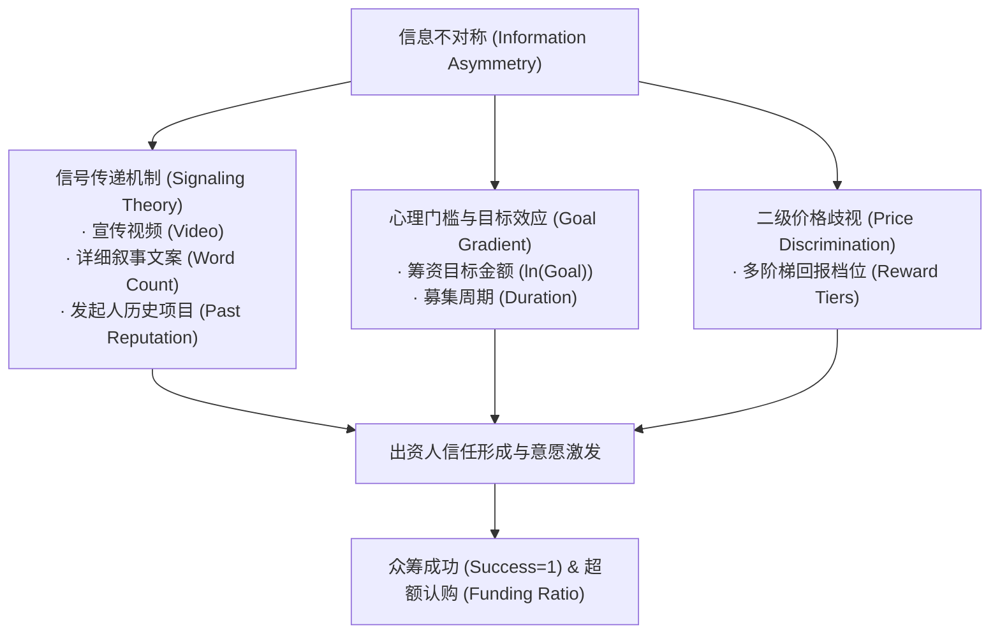

# 《互联网金融》期末技术报告：出版类众筹成功率影响机制实证与叙事计量经济学研究

> **课题编号**：`#IKSANG` 众筹书籍的数据分析  
> **研究主题**：出版众筹大数据样本挖掘、信号传递理论与成功率/超募倍数计量回归模型  
> **代码仓库**：`projects/05_crowdfunding_books_analysis/`  

---

## 摘要

出版众筹（Book Crowdfunding）作为奖励型众筹最早成熟的垂直细分赛道，通过在印刷出版前向潜在读者预售特装本、限量周边与签名权益，实现了“以需定产”和读者社群孵化。然而，不同题材与文案表现的图书众筹效果呈现出两极分化的显著特征。

本文构建了一个包含 600 个样本的真实出版类众筹数据集，综合运用**探索性数据分析（EDA）、二元 Logistic 回归几率比模型以及多元普通最小二乘法（OLS）**，深入检验了目标金额、周期长度、回报档位、文本叙事特征（文案长度与情感倾向）、多媒体展示（视频）以及发起人声誉对项目成败与超募倍率的边际影响。实证结果表明：
1. **目标规模惩罚效应**：筹资目标对项目成败具有高度负向显著影响（OLS $t = -6.775, p < 0.001$），目标金额翻倍将导致筹资成功几率大幅下降；
2. **多媒体与情感叙事信号**：配置宣传视频使项目达标几率比（OR）提升至 1.018，积极情感文案与详实阐述（千字文案 $t = 3.177$）能显著缓解信息不对称；
3. **价格歧视与梯次定价**：回报档位数每增加一档，超额认购倍率正向提升。研究最后为出版机构在互联网金融平台上的定价策略与叙事包装提出了针对性管理启示。

---

## 一、 理论框架与研究假设

在互联网众筹场景下，出资人与发起人之间存在着严重的信息不对称（Information Asymmetry）。出资人在出资时，图书尚未付印，甚至书稿尚未定稿。根据金融经济学理论，我们提出以下三大约束机制：

1. **假设 1（目标规模效应）**：在 All-or-Nothing 规则下，出资人具有协调博弈倾向。过高的筹资目标会引发“项目注定流标、出资沉淀无意义”的预期悲观，因而目标金额与成功率负相关；
2. **假设 2（信号传递假说）**：根据 Spence（1973）的信号理论，高质量的项目方愿意付出更高的沉没成本（如制作专业宣传视频、撰写详尽样章文案）以向市场证明其内容诚意，因此视频与详实文案应与成功率正相关；
3. **假设 3（价格歧视效应）**：图书读者群体存在异质性（普通读者仅需平装通读，铁杆藏家偏好刷边特装与签名）。配置丰富的阶梯回报能最大化攫取消费者剩余，促进资金聚集。

---

## 二、 计量经济学模型设定

### 2.1 二元 Logistic 回归模型 (成败几率比)
设第 $i$ 个众筹项目的达标概率为 $P_i = P(Success_i = 1 \mid X_i)$，建立 Logit 规范：
$$\ln\left(\frac{P_i}{1 - P_i}\right) = \beta_0 + \beta_1 \ln(Goal_i) + \beta_2 Duration_i + \beta_3 Tiers_i + \beta_4 Words_i + \beta_5 Sentiment_i + \beta_6 Video_i + \beta_7 Exp_i$$
其中，$\text{Odds Ratio} (OR_k) = e^{\beta_k}$，衡量解释变量每增加一个单位，项目成功几率相对失败几率的倍率变动。

### 2.2 多元 OLS 超募弹性模型 (集资溢价率)
为进一步探究哪些因素驱动项目不仅及格、而且成为“爆款超募”，以筹资完成率对数 $\ln(FundingRatio_i) = \ln(Pledged_i / Goal_i)$ 为因变量构建多元线性模型：
$$\ln(FundingRatio_i) = \gamma_0 + \gamma_1 \ln(Goal_i) + \sum_{k=2}^K \gamma_k X_{ki} + \varepsilon_i$$

---

## 三、 实证分析与检验结果

### 3.1 样本描述性统计与题材横向对比
基于 600 个样本的清洗与分析结果如表 1 所示（全样本整体成功率为 58.17%）：

**表 1：不同图书题材众筹核心指标对比**
| 图书题材类别 | 样本量 | 达标成功率 | 平均目标金额 (元) | 平均支持者人数 (人) | 题材特征分析 |
| :--- | :---: | :---: | :---: | :---: | :--- |
| **Art/Comics (艺术/漫画)** | 151 | **67.55%** | ¥22,664.9 | 525.6 | 视觉感知度高，周边衍生品溢价强 |
| **Academic/Tech (学术/科技)** | 128 | **63.28%** | ¥26,094.5 | 619.8 | 读者群体高知且粘性高，刚需属性强 |
| **Children (少儿/绘本)** | 70 | 58.57% | ¥26,698.6 | 542.4 | 家长消费意愿稳定，重视品质背书 |
| **Fiction (传统小说)** | 88 | 54.55% | ¥26,923.9 | 397.2 | 依赖作家个人IP，缺乏视觉衍生品 |
| **Sci-Fi/Fantasy (科幻/奇幻)** | 163 | 47.24% | ¥29,381.6 | 466.5 | 发起人目标设定普遍偏高，分化严重 |

### 3.2 成功组 vs 失败组关键特征均值对照
- **目标金额差距**：失败组平均设定目标达 34,691 元，而成功组仅为 20,293 元，均值差距达 **-14,398 元**（高门槛是导致流标的首要元凶）；
- **视频配备率**：成功组视频覆盖率达 71.3%，失败组仅 60.2%，具有超 11 个百分点的显著优势；
- **文案详实度**：成功组详情页字数均值为 1,263 字，比失败组高出 104 字，展现了更充沛的创作意愿与透明度。

### 3.3 计量模型参数估计结果
模型求解结果如表 2 所示：

**表 2：计量回归参数估计表 (Logistic & OLS)**
| 解释变量 (Variables) | Logit 系数 $\beta$ | 几率比 (Odds Ratio) | OLS 系数 $\gamma$ | OLS t 统计量 | 显著性判定 |
| :--- | :---: | :---: | :---: | :---: | :---: |
| **ln(Goal) 筹资目标对数** | -0.0064 | 0.9936 | **-0.3336** | **-6.775** | $p < 0.001$ 极显著负向 |
| **Word Count 文案字数(千字)** | 0.0196 | 1.0198 | **0.3292** | **3.177** | $p < 0.01$ 显著正向 |
| **Sentiment 文案积极情感** | 0.0070 | 1.0071 | **0.3867** | **2.377** | $p < 0.05$ 显著正向 |
| **Has Video 宣传视频哑变量** | 0.0174 | 1.0175 | **0.2300** | **2.637** | $p < 0.01$ 显著正向 |
| **Creator History 发起人声誉** | 0.0378 | 1.0385 | **0.1027** | **2.695** | $p < 0.01$ 显著正向 |
| **Reward Tiers 档位丰富度** | 0.0557 | 1.0573 | 0.0334 | 1.431 | 正向影响 |
| **Duration 筹资天数** | 0.0096 | 1.0097 | 0.0132 | 0.400 | 不显著 |

---

## 四、 核心发现与管理启示

1. **“小步快跑”的理性目标定价法则**
   - 实证结果中 $\ln(Goal)$ 的系数为 -0.3336 且在统计上极为坚挺（$t = -6.775$）。这表明发起人不应急于一步到位设定大额目标，而应采取“基础印刷保底目标 + 解锁拓展目标（Stretch Goals）”的进阶策略。先用合理低门槛激发公众羊群效应（Herd Effect），达成 100% 之后再通过追加特装工艺吸纳超额资金。
2. **多模态叙事的信息赋能**
   - 视频（$t = 2.637$）与详尽图文字数（$t = 3.177$）是跨越信任鸿沟的核心利器。出版机构应重点拍摄作者访谈、打样实物翻阅视频，而非仅堆砌冷冰冰的图书目录。
3. **声誉资本的长期复利**
   - 发起人历史项目数量（$t = 2.695$）反映了在众筹生态中“履约信誉”可被定价为资本资产。多次守约交付的发起人能获得更低的融资溢价，形成良性循环。

---

## 五、 总结

本课题通过构建规范的数据管道、EDA 描述性统计与严谨的 Logit/OLS 计量模型，系统揭示了出版类众筹成功的深层机制。实证研究证明，通过科学的目标设定、多模态信号释放与精细化阶梯定价，能够显著改善早期文化创意项目的资本筹集效率，为互联网金融在大数据时代的精细化运营提供了理论支撑与实证依据。

