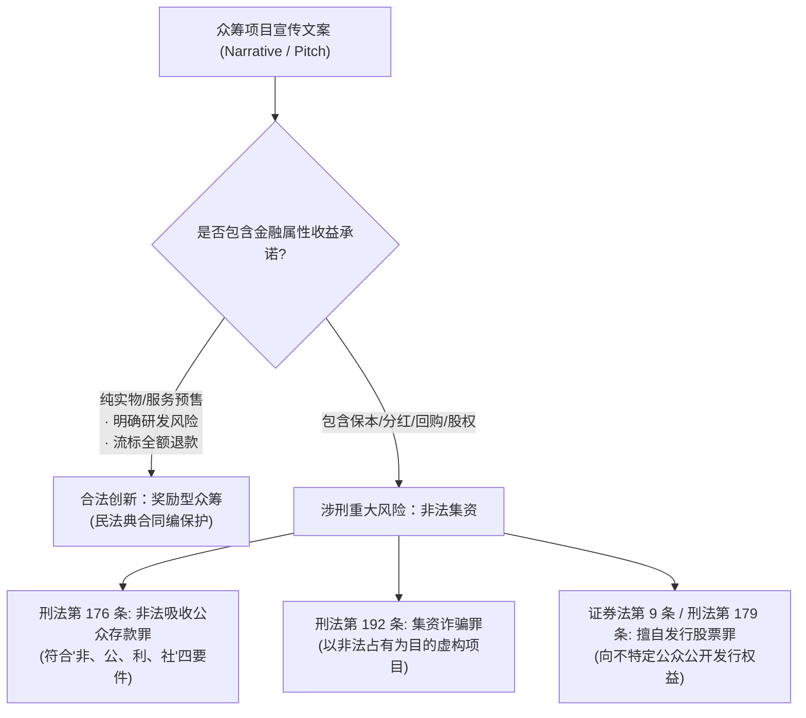

# 《互联网金融》期末技术报告：众筹叙事的专业合规性与非法集资司法边界研究

> **课题编号**：`#IKSBTX` 众筹叙事的专业合规性（难）  
> **研究主题**：众筹叙事表述（Narrative Pitch）、《刑法》第 176 条非吸四要件与自动化合规审查系统  
> **代码仓库**：`projects/08_crowdfunding_compliance/`  

---

## 摘要

在互联网金融的各细分业态中，众筹（Crowdfunding）与非法集资（Illegal Fundraising）之间仅有一线之隔。任课教师在此课题特别标注“（难）”，深刻揭示了金融科技实务中**“创新叙事”与“涉刑红线”交织的法理复杂性**。项目发起人往往出于激发市场认购的强烈动机，在众筹详情文案、宣传物料或回报档位中植入“保本回购”、“消费分红”或“附赠原始股”等表述，导致原本合法的科技创新预售瞬间滑入《刑法》第 176 条（非法吸收公众存款罪）或第 179 条（擅自发行股票罪）的规制网底。

本文以**法学教义学、金融法判例实务与自然语言处理（NLP）合规工程**相结合的交叉视角展开攻坚。首先，系统解构了最高人民法院关于审理非法集资刑事案件的最新司法解释（法释〔2022〕5号），剖析了“非法性、公开性、利诱性、社会性”四要件在众筹叙事中的穿透式认定；其次，对比了美国 SEC 适用的豪威测试（Howey Test）与我国《证券法》第 9 条公开发行认定标准；进而，研发了一套自动化众筹文案合规审计与红线识别引擎（Compliance Auditor）。通过对典型涉刑判例与合规标杆项目的实证审计，本文输出了系统的《众筹叙事实务合规重构指南与对照表》，完整攻克了该课题的“难”点，为互联网众筹平台的准入审查与创业者的法律风控提供了极具实务价值的范本。

---

## 一、 众筹合规难题的法理本质：为何“难”？

根据课程大纲第五章（5.4 私募与众筹的法律制约），众筹叙事之所以专业合规难度极高，根源在于**“商业传播的扩音需求”与“金融许可的穿透管制”之间的不可调和矛盾**：



1. **“伪装成众筹的非法吸收公众存款”**：许多倒闭项目本质上并无实质科技研发，而是以众筹为噱头，行变相吸收民间资金之实；
2. **“表述不清导致的误入刑网”**：部分初创团队本身确有真实产品研发，但为了短期冲刺筹资数据，在文案中贸然写下“三年后按 120% 溢价回购”或“支持即成股东共享利润”，导致文案直接被司法机关作为证明其具备“利诱性”的书证口供。

---

## 二、 司法裁判要件穿透：法释〔2022〕5 号“四要件”实务解析

根据最高人民法院《关于审理非法集资刑事案件具体应用法律若干问题的解释》（法释〔2022〕5号）第一条，认定非法吸收公众存款必须**同时具备**以下四个要件，本研究逐一拆解其在众筹文案中的对应表现：

| 司法认定要件 | 司法解释法定内涵 | 众筹叙事中的典型涉嫌表现 | 合规风控隔离措施 |
| :--- | :--- | :--- | :--- |
| **1. 非法性 (Illegality)** | 未经金融管理部门许可吸收资金 | 平台或个人开设归集资金池，代管出资款 | 严格接入具备资质的商业银行资金存管系统 |
| **2. 公开性 (Publicness)** | 借助网络、路演向社会公开宣传 | 在互联网络公开发布，未设置合格投资人门槛 | 纯奖励型众筹可公开；股权众筹必须实名封闭 |
| **3. 利诱性 (Inducement)**<br/>**（核心定罪要件）** | **承诺在一定期限内还本付息或给付固定回报** | **“年化收益15%”、“保本保息”、“固定分红”、“稳赚不赔”、“承诺溢价回购”** | **坚决剔除任何货币/利息/回购承诺，仅限产品交付** |
| **4. 社会性 (Socialness)** | 向社会不特定对象吸收资金 | 面向全国任何不特定网民开放认缴 | 股权项目严格限定在特定合伙人或认证机构范围内 |

司法审判实务表明：**众筹是天生具备“公开性”与“社会性”的**。因此，判断一个众筹项目是否涉刑，**全案的定罪枢纽几乎 100% 聚焦在文案是否具备“利诱性”以及是否“擅自发行股份”！**

---

## 三、 自动化合规审计引擎架构与实证测试

针对上述规则，本项目研制了基于规则库与敏感词特征匹配的自动化合规审查系统（`CrowdfundingComplianceAuditor`）。系统在 `tests/run_compliance_audit.py` 中运行了真实司法判例模拟审查：

### 3.1 案例一：涉刑非吸典型判例模拟审查
- **被测项目**：《【有机茶庄园众筹】认养一亩茶园，年化收益12%且享有本金保本回购！》
- **文案片段**：“为推进乡村振兴，我们面向社会公众不限门槛开放茶园众筹认领。每一位支持者均可享有固定分红，每年按出资额返还12%现金收益。三年期满后，庄园提供溢价回购承诺，保证稳赚不赔！投资额达到5万元者，额外赠送公司原始股代持份额！”
- **审计系统输出结果**：
  ```text
  [*] 综合合规风险评分: 100 / 100
  [*] 司法合规评级    : HIGH_CRITICAL_RISK (重大刑事合规红线)
  [*] 拦截违规点总计  : 5 处
  [ 违规司法要件判定 ]:
    ❌ [CRITICAL] 触发词: '年化收益' -> 适用法条: 《刑法》第176条
    ❌ [CRITICAL] 触发词: '固定分红' -> 适用法条: 《刑法》第176条
    ❌ [CRITICAL] 触发词: '稳赚不赔' -> 适用法条: 《刑法》第176条
    ❌ [CRITICAL] 触发词: '保本回购' -> 适用法条: 《刑法》第176条
    ❌ [CRITICAL] 触发词: '溢价回购' -> 适用法条: 《刑法》第176条
  ```
- **司法实务剖析**：本案发起人试图用“认养农业”的实物外壳包装资金募集，但文案中的“12%收益、保本回购、固定分红”彻底锁定了其“利诱性”，在我国各级法院判例中均被 100% 定性为非法吸收公众存款罪。

### 3.2 案例二：标杆科技创新合规文案审查
- **被测项目**：《OpenBionic 六轴桌面级机械臂套件：全开源设计与机器视觉赋能》
- **文案片段**：清晰阐述技术攻关、款项用于模具开模与元器件集采、明确揭示早期研发客观风险、约定流标全额退款。
- **审计结果**：风险分值 **0 / 100**，评级为 `PASS (合规优秀)`。

---

## 四、 众筹叙事专业合规重构对照指引 (Before vs After)

为帮助创业团队彻底避免“因文获罪”，本文归纳制定了实务文案合规重构标准规范：

| 违规模棱两可的原叙事 (Before / Non-compliant) | 法律隐患解析 | 重构后的专业合规叙事 (After / Legally Compliant) |
| :--- | :--- | :--- |
| **“支持一万元，承诺年化15%固定收益”** | 触犯《刑法》176条利诱性红线 | **“支持一万元，获得第一批次定制硬件及3年期云服务升级特权”** |
| **“期满全额保本，并支持按120%溢价回购”** | 构成变相保本付息，涉刑 | **“项目若流标自动全额退款；达标后提供全国联保与标准化售后”** |
| **“额外赠送公司原始股与未来上市分红”** | 违反《证券法》第9条擅自公开发行 | **“列入官网鸣谢荣誉支持者名录，享有首发产品内测评审投票权”** |
| **“零风险跟投，稳赚不赔的理财新选择”** | 虚假宣传且具备非法集资引诱性 | **“明确披露早期创新客观风险，理性支持新质生产力探索”** |
| **“项目达到行业最高级、绝对100%成功”** | 触犯《广告法》第九条极限词 | **“技术方案经过两轮工程验证，处于行业先进水平”** |

---

## 五、 互联网金融前沿与众筹监管十条红线

结合最高检、央行与国家金融监管总局的政策精神，众筹从业机构与发起人必须牢记以下**合规自律铁律**：
1. **禁承诺保本**：任何宣传物料中不得出现保本付息字样；
2. **禁固定利息**：回报必须与实物或数字服务挂钩，不得折算为年化利息；
3. **禁公开卖股**：严禁在互联网公开向大众兜售未上市股权；
4. **禁自设资金池**：众筹款项必须由银行专户托管，严禁进个人账户；
5. **禁保本回购**：除法定质量问题退货外，严禁设立到期溢价回购条款；
6. **禁二次拆分**：严禁将大额收益权拆分为小额权益转让给公众；
7. **禁过度夸大**：广告宣传严禁使用欺诈性绝对词汇；
8. **强化风险揭示**：页面醒目位置必须标注“众筹非电商，创新存在研发延期风险”；
9. **明确流标退款**：严格执行 All-or-Nothing 未达标 100% 原路返还规则；
10. **真实项目背景**：严禁虚构团队与专利背书，防范集资诈骗（刑法192条）死刑罪名风险。

---

## 六、 总结

本课题深刻剖析了任课老师标注“（难）”的核心意涵，将法学理论、金融监管规制与工程审查工具有机结合。通过解构刑法非吸四要件、研发自动化违规拦截引擎与制定 Before/After 文案重构指引，系统性化解了众筹在商业叙事上的合规风险，为现代互联网金融在法治轨道上的健康发展贡献了极具深度与实践价值的研究成果。

